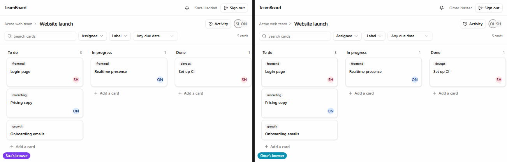
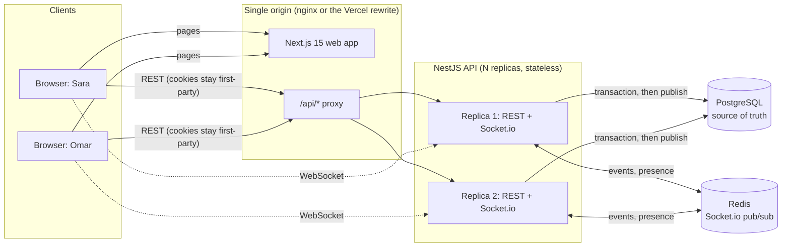

# TeamBoard

A real-time collaborative Kanban board for small teams. Create a workspace, invite teammates with a role, and plan work on boards of columns and cards. Every change shows up for everyone looking at the board, instantly and without a refresh. The server is the source of truth, the UI updates optimistically, and the API scales horizontally behind a load balancer.



_Sara (left) and Omar (right) in two separate browsers. Recorded by a script (`pnpm docs:gif`), not by hand._

## Features

- **Live boards:** create, edit, move, reorder and delete cards and columns. Everyone on the board sees each change as it lands, with presence avatars and "Sara is editing" markers.
- **Drag and drop with the mouse or the keyboard:** Space picks a card up, arrows move it, Space drops it, and the screen reader hears the projected position.
- **Optimistic UI:** changes apply instantly. A rejected change rolls back only what it touched, so it never undoes someone else's newer move.
- **Workspaces and roles:** owner, admin, member and viewer, enforced on every route and socket join (see the [RBAC matrix](#roles-and-permissions)). Invite links expire after 48 hours.
- **Activity log:** per board and per card, in sentences ("Sara moved 'Login page' from To do to In progress"). It stays readable after renames and deletes.
- **Notifications:** you're notified when someone assigns you or `@mentions` you, with a bell, an unread count, and live delivery over the socket.
- **Card details:** Markdown descriptions and comments, labels, assignees, due dates, and URL-based filters.
- **Production-ready setup:**
  - non-root multi-stage Docker images;
  - a one-host production compose file;
  - GitHub Actions with Postgres and Redis service containers;
  - deploy config for Vercel, Render, Neon and Upstash ([DEPLOY.md](DEPLOY.md)).

## Architecture



| Package           | Stack                                                                                                          |
| ----------------- | -------------------------------------------------------------------------------------------------------------- |
| `apps/api`        | NestJS 11, Prisma 7 (PostgreSQL 18), Socket.io 4 + Redis adapter, JWT access tokens + rotating refresh cookies |
| `apps/web`        | Next.js 15 (App Router), React 19, Tailwind 4, shadcn/ui, dnd-kit, TanStack Query                              |
| `packages/shared` | Zod schemas and types, the permission matrix, socket event contract, fractional ordering                       |

One contract for both sides: every request body, response and socket payload is a Zod schema in `@teamboard/shared`. The API validates with it, the web app parses with it, and the types come from it.

## How scaling works

The API is stateless, so you can run as many replicas as you like behind any load balancer. Realtime stays correct across them:

1. **REST is the only write path.** A write runs in a Postgres transaction, together with its activity row and any notifications. Only **after the commit** does the service publish a typed event (`card.moved`, `comment.created`, …) to the room `board:<id>`. A rolled-back write never emits anything.
2. **The Socket.io Redis adapter fans the event out.** `server.to('board:<id>').emit(...)` on replica 1 goes through Redis pub/sub to every replica, and each one delivers it to its own sockets in that room. Personal events (`notification:new`, access revoked) use a `user:<id>` room the same way.
3. **No sticky sessions.** Clients use the WebSocket transport only (no long-polling), so each connection lives on one replica from start to finish. Round-robin or least-connections balancing just works.
4. **Presence is computed, never stored.** "Who's here" is `fetchSockets()` on the board room, which asks every replica over Redis and is deduplicated by user. A crashed replica's users simply disappear; there's nothing to clean up.
5. **Clients converge.**
   - Each event carries the entity's `version`, and clients drop anything older than what they have.
   - A tab ignores the echo of its own change (`X-Client-Id`).
   - After any reconnect, the client rejoins and refetches the board, so missed events don't matter.
6. **Access changes reach every replica.** Removing a member makes their sockets leave the workspace's rooms on all instances (`socketsLeave` on `user:<id>`). Their open board shows "access lost" at once.

The proof is a script: `pnpm realtime:scale-smoke`. It opens sockets until it has one on each of two replicas behind nginx, then writes through REST and checks that both replicas deliver every event, whichever replica handled the write.

```bash
docker compose --profile scale up -d --build --wait   # 2 API replicas + nginx on :8080
pnpm realtime:scale-smoke
docker compose --profile scale rm -sf api nginx migrate
```

## Roles and permissions

The matrix below is generated from `PERMISSIONS` in [`packages/shared/src/roles.ts`](packages/shared/src/roles.ts), the same object the API enforces with `@RequireRole(action)`. CI fails if the two drift apart (`pnpm docs:rbac --check`). On every route, someone who isn't a member gets the same 404 as an unknown id, and a member whose role is too low gets a 403.

<!-- rbac:start (generated by `pnpm docs:rbac` from packages/shared/src/roles.ts) -->

| Action                        | Owner | Admin | Member | Viewer |
| ----------------------------- | :---: | :---: | :----: | :----: |
| `workspace.read`              |  ✅   |  ✅   |   ✅   |   ✅   |
| `workspace.leave`⁴            |  ✅   |  ✅   |   ✅   |   ✅   |
| `workspace.update`            |  ✅   |   —   |   —    |   —    |
| `workspace.delete`            |  ✅   |   —   |   —    |   —    |
| `workspace.transferOwnership` |  ✅   |   —   |   —    |   —    |
| `member.read`                 |  ✅   |  ✅   |   ✅   |   ✅   |
| `member.manage`³              |  ✅   |  ✅   |   —    |   —    |
| `invitation.read`             |  ✅   |  ✅   |   —    |   —    |
| `invitation.create`           |  ✅   |  ✅   |   —    |   —    |
| `invitation.revoke`           |  ✅   |  ✅   |   —    |   —    |
| `board.read`                  |  ✅   |  ✅   |   ✅   |   ✅   |
| `board.create`                |  ✅   |  ✅   |   —    |   —    |
| `board.update`                |  ✅   |  ✅   |   —    |   —    |
| `board.delete`                |  ✅   |  ✅   |   —    |   —    |
| `column.create`               |  ✅   |  ✅   |   —    |   —    |
| `column.update`               |  ✅   |  ✅   |   —    |   —    |
| `column.move`                 |  ✅   |  ✅   |   —    |   —    |
| `column.delete`               |  ✅   |  ✅   |   —    |   —    |
| `card.read`                   |  ✅   |  ✅   |   ✅   |   ✅   |
| `card.create`                 |  ✅   |  ✅   |   ✅   |   —    |
| `card.update`                 |  ✅   |  ✅   |   ✅   |   —    |
| `card.move`                   |  ✅   |  ✅   |   ✅   |   —    |
| `card.delete`                 |  ✅   |  ✅   |   ✅   |   —    |
| `comment.read`                |  ✅   |  ✅   |   ✅   |   ✅   |
| `comment.create`              |  ✅   |  ✅   |   ✅   |   —    |
| `comment.update`¹             |  ✅   |  ✅   |   ✅   |   —    |
| `comment.delete`²             |  ✅   |  ✅   |   ✅   |   —    |
| `activity.read`               |  ✅   |  ✅   |   ✅   |   ✅   |

¹ Only the comment’s author can edit it.  
² The author, or an admin or owner, can delete a comment.  
³ Admins manage members and viewers and can grant up to admin; nobody changes or removes the owner, and ownership moves only by transfer.  
⁴ The owner has to transfer ownership before leaving.

<!-- rbac:end -->

## Quick start

Requirements: Node 24, pnpm 10 (via Corepack) and Docker.

```bash
corepack enable pnpm
pnpm install
cp apps/api/.env.example apps/api/.env          # set a real JWT_ACCESS_SECRET
cp apps/web/.env.example apps/web/.env.local
docker compose up -d --wait                     # Postgres on 5433, Redis on 6379
pnpm db:migrate && pnpm db:seed                 # demo@teamboard.dev / demo-password
pnpm dev                                        # web http://localhost:3000, API http://localhost:4000/docs
```

To try the realtime part, sign in as `demo@teamboard.dev` in one browser and `member@teamboard.dev` in another (both use `demo-password`), then open the same board.

**The whole production stack on one machine** (two API replicas, Next.js standalone server, nginx as the single origin):

```bash
cp .env.prod.example .env.prod                  # set real secrets
docker compose -f docker-compose.prod.yml --env-file .env.prod up -d --build --wait
# then open http://localhost:8090
```

Deploying publicly (Vercel + Render + Neon + Upstash, with a one-click demo for Sara and Omar) is covered step by step in [DEPLOY.md](DEPLOY.md).

## Testing

| Command         | What runs                                                                                                        |
| --------------- | ---------------------------------------------------------------------------------------------------------------- |
| `pnpm check`    | lint, typecheck, and unit tests (Jest for the API, Vitest for web and shared)                                    |
| `pnpm test:int` | 295 API integration tests with supertest and real sockets, against Postgres + Redis                             |
| `pnpm e2e`      | Playwright: auth flows, drag and drop (pointer + keyboard), and two-browser realtime, presence and notifications |
| `pnpm docs:gif` | re-records `docs/live-demo.gif` from a scripted two-browser session                                              |

The integration suite covers the full access matrix for every role against every route, tenant isolation (ids from another workspace look exactly like random ids), refresh-token reuse detection, concurrent moves, and event delivery across two API instances.

## Project layout

```
apps/api          NestJS API: auth, access (RBAC guards), boards, realtime, notifications, activity
apps/web          Next.js app: features/ (auth, boards, notifications), lib/ (API client, socket)
packages/shared   Zod schemas, PERMISSIONS, socket contract, describeActivity, ordering
docker/           nginx configs for the scale profile and the prod compose
.github/workflows ci.yml, deploy.yml, demo-reset.yml
```

[DEPLOY.md](DEPLOY.md) walks through deploying to Vercel, Render, Neon and Upstash.
